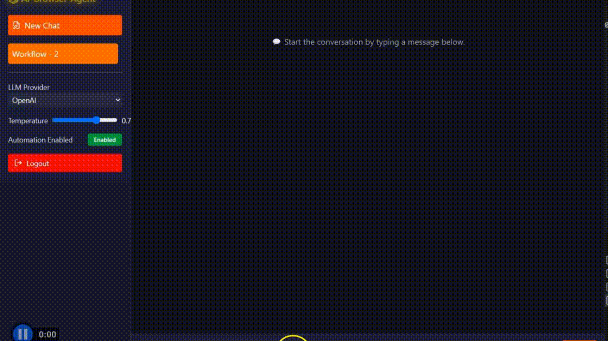

# AI Browser Agent

A privacy-preserving AI assistant that automates tasks like ticket booking, form filling, and web scraping directly in your local browser using LLMs, Browser-Use and Electron.

## Overview

The AI Browser Agent is a locally run desktop application designed to help users automate complex web-based tasks through natural language commands. Unlike cloud-based assistants, it executes all actions directly on the user's device, ensuring that sensitive information such as passwords, personal data, and browsing activity never leave the local environment.

By integrating large language models (LLMs) with browser automation frameworks like Browser-use, the agent can understand user intents, analyze the content of multiple open browser tabs, and perform multi-step tasks autonomously. The use of Microsoft’s Semantic Kernel adds an extra layer of controlled, secure execution for each automation steps.


## Features

- Chat interface for conversational task instructions
- End-to-end local execution; no data sent to cloud servers
- Automated task execution across browser tabs
- Browser content analysis using Playwright
- Workflow planning using large language models (LLMs)
- Semantic Kernel integration for structured and secure task execution
- Built with React, Electron, Express, Firebase, Python and Node

---
## 🎥 Demo Workflow Walkthorugh [AI Browser Agent]



## Example Use Case

## ✈️ Flight Booking Use Case

This visual demonstrates how an AI agent processes a user's request to book a flight from **London to New York on August 30, 2025**.

The task flows through a **Plan → Act → Observe** loop:

1. **Plan:** The agent understands the user's intent and extracts relevant parameters such as:
   - Departure location: London  
   - Destination: New York  
   - Travel date: August 30, 2025

2. **Act:** The agent inputs these parameters into the booking system and initiates a search for available flights.

3. **Observe:** The system monitors the results and selects or displays a suitable flight.

A mock flight result is shown to illustrate the system’s response and how the loop completes successfully.

This use case highlights the AI agent’s ability to make autonomous decisions in real-world travel scenarios, showcasing end-to-end automation and intelligent reasoning.


## 🛒 Grocery Shopping Use Case

This image illustrates an AI assistant executing a command to add **tomatoes** to a Tesco grocery cart.

Following the **Observe → Plan → Act** cycle:

1. **Observe:** The assistant analyzes the interface and detects relevant product listings.
2. **Plan:** It understands the intent to add tomatoes and identifies the correct action.
3. **Act:** The agent clicks the “Add to cart” button associated with the correct item.

The visual demonstrates how the AI assistant interacts autonomously with mobile web interfaces, simulating human-like task execution by:

- Observing available items  
- Planning next steps  
- Acting based on context

This use case showcases the AI’s capability in **e-commerce automation**, making routine tasks like grocery shopping seamless and intelligent.


---

## Project Workflow


---

## 👩‍💻 Tech Stack

| Component            | Technology                                      |
|----------------------|-------------------------------------------------|
| UI                   | React, Electron, Tailwind CSS                   |
| Backend              | Python, Express (Node.js), Firebase Admin SDK   |
| Browser Automation   | Browser-Use (playwright)                         |
| Planning             | OpenAI GPT / Claude Anthorpic                   |

---

## 📂 Project Structure

```
ai-browser-agent/
│
├── backend-node
│   ├── agentExecutor.js
│   ├── intentParser.js
│   ├── llmActionPlanner.js
│   ├── llmAnswerAgent.js
│   ├── mcp.js
│   ├── package-lock.json
│   ├── package.json
│   ├── parser.js
│   ├── routes
│   │   └── commandRoutes.js
│   ├── server.js
│   └── siteHandlers
│       ├── amazon.js
│       └── tesco.js
│
├── backend-python/ # Python backend for AI/LLM workflows
│ ├── .cursor/rules/ # Cursor IDE rules & configurations
│ │ └── general.mdc
│ │
│ ├── bin/ # Shell scripts for setup, linting, and tests
│ │ ├── lint.sh
│ │ ├── setup.sh
│ │ └── test.sh
│ │
│ ├── llm/ # Core LLM-related modules
│ │ ├── init.py
│ │ ├── llm_automation.py # Automation workflows using LLMs
│ │ └── llm_chat.py # Chat/interaction logic with LLMs
│ │
│ ├── schemas/ # (Future) Data validation schemas (e.g., Pydantic)
│ │
│ ├── utils/ # Utility/helper functions
│ │ ├── init.py
│ │ └── check_api_key.py # API key validation for external services
│ │
│ ├── .gitignore # Ignore files from version control
│ ├── .python-version # Python version specification
│ ├── pyproject.toml # Python dependencies & build configuration
│ ├── README.md # Python backend documentation
│ └── server.py # Main backend server entry point
│
├── docs
│   ├── llm-integration-decision.pdf
│   ├── project-workflow.png
│   ├── use-case-flight-booking.jpg
│   └── use-case-grocery-ordering.jpg
├── examples
│   ├── working-example-0.png
│   ├── working-example-1.png
│   ├── working-example-2.png
│   ├── working-example-3.png
│   └── working-example-4.png
├── frontend
│   ├── cypress
│   │   ├── component
│   │   │   ├── BackButton.cy.jsx
│   │   │   └── Footer.cy.jsx
│   │   ├── e2e
│   │   │   ├── auth_login.cy.js
│   │   │   ├── auth_signup.cy.js
│   │   │   ├── chatpage.cy.js
│   │   │   ├── home.cy.js
│   │   │   ├── loginpage.cy.js
│   │   │   └── signuppage.cy.js
│   │   ├── fixtures
│   │   │   └── example.json
│   │   └── support
│   │       ├── commands.js
│   │       ├── component-index.html
│   │       ├── component.js
│   │       └── e2e.js
│   ├── cypress.config.js
│   ├── electron
│   │   ├── assets
│   │   │   ├── icon-rounded.png
│   │   │   ├── icon-transparent.png
│   │   │   └── icon.png
│   │   ├── main.mjs
│   │   ├── preload.js
│   │   └── splash.html
│   ├── eslint.config.js
│   ├── index.html
│   ├── package-lock.json
│   ├── package.json
│   ├── public
│   │   └── favicon-32x32.png
│   ├── src
│   │   ├── App.jsx
│   │   ├── assets
│   │   │   ├── feature-1.png
│   │   │   ├── feature-2.png
│   │   │   ├── feature-3.png
│   │   │   ├── feature-4.png
│   │   │   └── icon-rounded.png
│   │   ├── components
│   │   │   ├── Animation
│   │   │   │   └── LightningCanvas.jsx
│   │   │   ├── Auth
│   │   │   │   ├── AuthContainer.jsx
│   │   │   │   ├── LoginForm.jsx
│   │   │   │   ├── LogoBlock.jsx
│   │   │   │   ├── SignupForm.jsx
│   │   │   │   ├── SocialLogin.jsx
│   │   │   │   └── SocialSignup.jsx
│   │   │   ├── BackButton.jsx
│   │   │   ├── Chat
│   │   │   │   ├── MessageBubble.jsx
│   │   │   │   ├── MessageInput.jsx
│   │   │   │   ├── MessageList.jsx
│   │   │   │   └── Sidebar.jsx
│   │   │   ├── Footer.jsx
│   │   │   └── Home
│   │   │       ├── DemoPreview.jsx
│   │   │       ├── FeatureCards.jsx
│   │   │       ├── HeroSection.jsx
│   │   │       ├── HeroSectionCustomerReview.jsx
│   │   │       ├── IntegrationGrid.jsx
│   │   │       └── Navbar.jsx
│   │   ├── contexts
│   │   │   ├── AuthContext.jsx
│   │   │   └── ChatContext.jsx
│   │   ├── firebase
│   │   │   └── config.js
│   │   ├── hooks
│   │   │   └── useFirebaseAuth.js
│   │   ├── index.css
│   │   ├── main.jsx
│   │   ├── pages
│   │   │   ├── Chat.jsx
│   │   │   ├── Home.jsx
│   │   │   ├── Login.jsx
│   │   │   └── Signup.jsx
│   │   └── store
│   │       └── useUserStore.js
│   ├── tailwind.config.js
│   ├── vite.config.js
│   └── vitest.setup.js
├── LICENSE
├── minutes_of_meeting
│   └── minutes_of_meeting.xlsx
├── python_agent
│   ├── __pycache__
│   │   ├── python_agent.cpython-312.pyc
│   │   └── python_agent.cpython-313.pyc
│   ├── python_agent.py
│   └── requirements.txt
├── README.md
├── SCRUM_LINKS.md
└── sprints
    └── sprints.md
```

## Installation

 **Clone the Repository**

```bash
git clone https://github.com/AyushPoojariUCD/ai-browser-agent.git
cd ai-browser-agent
```

**Navigate to the Frontend Directory**

```bash
cd frontend
```
**Install Dependencies**
```
npm install
```

**Install Dependencies**
```
npm install electron
```

- NOTE: `Configure firebase/config`

**Steps to run Frontend : `AI Browser Agent`**
```
npm run electron-dev

npm run electron
```

**Steps to run Backend : `AI Browser Agent`**
```
node server.js

```

---

## Additional Resources
- [LLM Integration Decision](https://github.com/AyushPoojariUCD/ai-browser-agent/blob/main/docs/llm-integration-decision.pdf)
- [Project Plan](https://github.com/Soham-2211/AI-Browser-Agent/blob/main/Project%20Plan.pdf)
- [Documentation](https://your-video-link.com)  
- [Video Demonstration](https://your-video-link.com)  


## Team Members : `Coding Thumbs 👍`

- **Tarun Kumar**  
- **Ayush Poojari**
- **Deepak Shelke**
- **Sudhanshu Ghuge**    
- **Preet Raut** 
- **Soham Deo**
